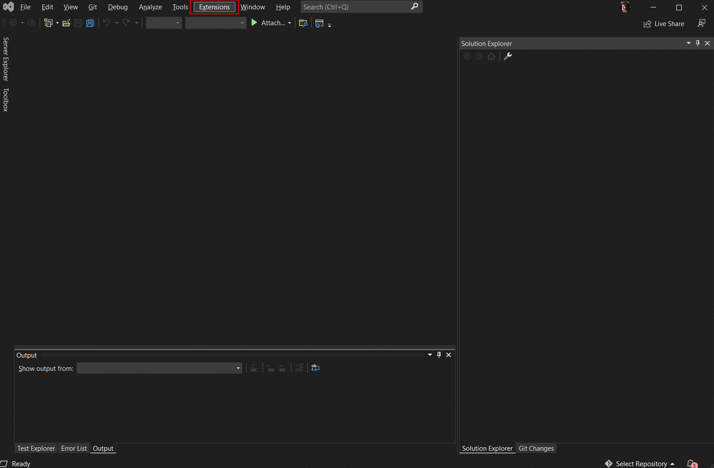

 

-----

# Welcome to the .NET **nanoFramework** Visual Studio extension repository!

This repo contains .NET **nanoFramework** Visual Studio extension and associated tools.

## Build status

| Component | Build Status | Stable version | Preview version |
|:-|---|---|---|
| Visual Studio 2022+2026 extension |  |  | 
| Visual Studio 2019 extension |  |  | | 

## Feedback and documentation

For documentation, providing feedback, issues and finding out how to contribute please refer to the [Home repo](https://github.com/nanoframework/Home).

Join our Discord community [here](https://discord.gg/gCyBu8T).

## Telemetry

The .NET **nanoFramework** Visual Studio extension collects anonymous usage telemetry. It helps us understand which features, boards and firmware versions are actually used, and which operations fail, so that we can focus on what matters. A short notice is shown in the output pane and in an info bar the first time the extension loads (once per major version).

### Opting out

Set either of these environment variables to `1` (or `true`) and restart Visual Studio:

- `NANOFRAMEWORK_TELEMETRY_OPTOUT`
- `DO_NOT_TRACK`

These are the same variables used by [nanoff](https://github.com/nanoframework/nanoFirmwareFlasher#telemetry), so opting out once covers both tools. The "Opt out" action in the info bar sets `NANOFRAMEWORK_TELEMETRY_OPTOUT=1` for the current user. When opted out, no telemetry is collected or sent.

### What is collected

| Data | Details |
|---|---|
| Operations | Deploy, debug launch and debug session, firmware update, virtual device start, nanoclr install/update and the Device Explorer commands (ping, device capabilities, erase, network configuration, reboot): the outcome (e.g. `OK`, `NoDevice`, `NotConnecting`), the duration and a few counters and flags (e.g. number of assemblies and total size deployed, whether a retry was needed, reboot type). |
| Devices | Target name, platform, transport (serial, network, USB), whether it's the virtual device, nanoCLR and firmware versions and the boot loader type. Recorded once per device per Visual Studio session and with each operation. |
| Projects | Output type and whether it's a unit test project, once per project per session. |
| Settings | The extension settings when it loads and when they're changed, as on/off values only. Settings holding paths or port names are only recorded as set or not set. |
| Device Explorer | Use of the tool window, toggles and which of the links was clicked. For the settings, network configuration and help dialogs: how they were closed (saved, cancelled or closed), how long they were open, which tabs were viewed and which actions were used (e.g. a certificate was selected, the virtual device was started), never the values entered or the files chosen. |
| Errors | Exception type, innermost exception type, HRESULT and stack trace (with user profile paths, user name and machine name removed), plus where in the extension the error occurred. |
| Environment | Extension version, Visual Studio version, OS architecture, .NET runtime, and an anonymous install ID: a random GUID stored in `~/.nanoFramework/telemetry.id`, shared with nanoff. |

### What is never collected

- Project, solution, assembly or file names and paths.
- Serial port names, device unique IDs, serial numbers and MAC addresses.
- Network configuration values: IP addresses, SSIDs, passwords and certificates.
- Exception messages.
- User names or machine names.

Telemetry is sent to Azure Monitor (Application Insights) using OpenTelemetry. By default, Application Insights derives an approximate location (country/city) from the IP address and doesn't store the IP address itself. The extension doesn't send the IP address as part of its telemetry data. Telemetry that can't be sent is kept in `~/.nanoFramework/telemetry-vs` and retried later.

## Visual Studio extension distribution

**nanoFramework** Visual Studio extension is distributed through Visual Studio Marketplace. You can either search it on the marketplace or follow the URLs above for the appropriate version.

This is the experience you'll have when installing the extension:

And when creating your first project:

## Developing for the Visual Studio extension

If you are working on developing code for **nanoFramework** Visual Studio extension please take a look at the available documentation [here](docs/README.md).

## Credits

The list of contributors to this project can be found at [CONTRIBUTORS](https://github.com/nanoframework/Home/blob/main/CONTRIBUTORS.md).

## Icons

The icons used in the extension are courtesy of [Icons8](https://icons8.com). Thank you very much for your great work!

## License

The **nanoFramework** Visual Studio extension and associated tools are licensed under the [MIT license](LICENSE.md).

## Code of Conduct

This project has adopted the code of conduct defined by the Contributor Covenant to clarify expected behavior in our community.
For more information see the [.NET Foundation Code of Conduct](https://dotnetfoundation.org/code-of-conduct).

### .NET Foundation

This project is supported by the [.NET Foundation](https://dotnetfoundation.org).
